<div align="center">

  

  # 📝 Awesome Note-Taking &amp; Organization Tools

  <p align="center">
    <strong>A curated directory of top-tier Note-Taking applications, Personal Knowledge Management (PKM) systems, Second Brain architectures, local-first outliners, and zero-knowledge encrypted sync platforms.</strong>
  </p>

  <p align="center">
    <a href="https://github.com/ishandutta2007/Awesome-Awesome-Awesome"></a><a href="https://discord.gg/jc4xtF58Ve"></a>
    <a href="https://github.com/ishandutta2007/Awesome-Note-Taking-Organization/stargazers"></a>
    <a href="https://github.com/ishandutta2007/Awesome-Note-Taking-Organization/network/members"></a>
    <a href="https://github.com/ishandutta2007/Awesome-Note-Taking-Organization/blob/main/LICENSE"></a>
    <a href="https://github.com/ishandutta2007/Awesome-Note-Taking-Organization/pulls"></a>
    <a href="https://github.com/ishandutta2007"></a>
  </p>

</div>

---

## 📖 Overview &amp; Architecture Landscape

In an era of relentless information overload, capturing thoughts, structuring research, synthesising mental models, and executing digital project workflows demands purpose-built **Note-Taking &amp; Knowledge Organization** infrastructure. Modern software paradigms have progressed far beyond static yellow sticky notes into sophisticated **Personal Knowledge Management (PKM)** frameworks, **Building a Second Brain (BASB)** architectures, Niklas Luhmann's **Zettelkasten** indexing, and canvas-based spatial thinking.

This repository tracks the entire spectrum of digital note-taking:
- **Cloud-Native All-In-One Workspaces**: Multi-tenant relational databases and docs offering collaborative workspaces.
- **Local-First &amp; Plain-Text Sovereignty**: File-over-app architectures storing plain Markdown (`.md`) files on local disks to ensure generational data longevity without proprietary cloud lock-in.
- **Zero-Knowledge End-to-End Encryption (E2EE)**: Cryptographically secured sync protocols (Argon2, XChaCha20-Poly1305) guaranteeing privacy even against server operators.
- **Networked Thought &amp; Bidirectional Graphs**: Outliner and graph-driven tools connecting atomic ideas through semantic wikilinks (`[[Note Name]]`).

---

## 📑 Table of Contents

- [🌐 Sector Overview &amp; Market Dynamics](#-sector-overview--market-dynamics)
- [☁️ SaaS &amp; Commercial Note-Taking Platforms](#️-saas--commercial-note-taking-platforms)
- [🔓 Open-Source GitHub Projects (Ranked by Stars)](#-open-source-github-projects-ranked-by-stars)
- [📊 Architectural Comparison Matrix](#-architectural-comparison-matrix)
- [🧠 Methodologies: Zettelkasten, PARA &amp; Networked Thought](#-methodologies-zettelkasten-para--networked-thought)
- [🤝 How to Contribute](#-how-to-contribute)
- [📈 Star History](#-star-history)
- [💖 Support &amp; Sponsorship](#-support--sponsorship)
- [⚖️ Disclaimer](#️-disclaimer)

---

## 🌐 Sector Overview &amp; Market Dynamics

The global **Note-Taking and Knowledge Management Software market** was valued at approximately **$7.4 Billion in 2024** and is projected to expand to **$16.8 Billion by 2032**, exhibiting a robust Compound Annual Growth Rate (**CAGR of ~10.8%**). This accelerating expansion is propelled by distributed remote workforces, digital research automation, the widespread adoption of Personal Knowledge Management (PKM) methodologies, and enterprise urgency for searchable institutional memory.

Market concentration follows a two-tier **moderately fragmented** structure:
1. **Casual &amp; Enterprise Workspace Layer (Concentrated / Winner-Take-Most)**: Cloud hyperscalers and all-in-one productivity suites (Microsoft OneNote, Google Keep/Docs, Apple Notes, and Notion) command high mass-market volume and team documentation through default operating system bundling, multi-user real-time collaboration, and ecosystem lock-in.
2. **Power-User, PKM &amp; Local-First Layer (Highly Fragmented)**: A vibrant, decentralized tier of specialized contenders—anchored by Obsidian, Logseq, Joplin, AppFlowy, and AFFiNE—commands fierce user loyalty. This sector actively challenges cloud lock-in, competing intensely on **zero-knowledge encryption (E2EE)**, open file standards (plain Markdown), offline-first resilience, and extensible open-source plugin ecosystems.

---

## ☁️ SaaS &amp; Commercial Note-Taking Platforms

The table below catalogs leading commercial and hosted note-taking platforms, sorted **descending by company scale (valuation or annual revenue)**:

| Platform | Company Scale / Valuation | Starting Tier Price | Free Tier Limits | Storage &amp; Sync Architecture | Primary Sweet Spot |
| :--- | :--- | :--- | :--- | :--- | :--- |
| **[Notion](https://www.notion.so/)** | **~$10.0 Billion Valuation** (Late-stage VC; ~$350M+ ARR) | **$10/user/mo** ($8/user/mo billed annually) for Plus plan | **Free forever plan**: Unlimited pages and blocks for individuals, up to 10 guest collaborators, 5MB file upload limit, 7-day page revision history, and basic page analytics | Multi-tenant cloud relational database; proprietary JSON block format; limited offline cache | Collaborative team wikis, relational databases, project sprint management, and modular doc hubs |
| **[Evernote](https://evernote.com/)** | **~$2.55 Billion Valuation** (Parent Bending Spoons; ~$100M+ ARR) | **$14.99/mo** ($129.99/yr, ~$10.83/mo) for Personal plan | **Free forever plan**: Hard-capped at **50 total notes**, **1 single notebook**, **1 connected device**, 60MB monthly upload bandwidth, and 25MB max single note size | Centralized cloud storage; proprietary ENML format; server-side OCR and attachment indexing | Legacy archives, receipt capture, PDF full-text OCR indexing, and universal multi-platform web clipping |
| **[Roam Research](https://roamresearch.com/)** | **~$200 Million Valuation** ($9M seed round at $200M cap) | **$15/mo** ($180/yr billed annually) for Pro plan | **30-day free trial** with full feature access and unlimited graphs/devices; **0 permanent free plan** (paid subscription mandatory post-trial) | Cloud-synchronized bidirectional block-level graph database (EDN/ClojureScript); browser local storage cache | Academics, researchers, and zettelkasten practitioners creating deeply cross-referenced networked graphs |
| **[Craft Docs](https://www.craft.do/)** | **~$60 Million Valuation** ($12.2M Series A led by Creandum) | **$10/user/mo** ($8/user/mo billed annually) for Plus plan | **Free forever plan**: Capped at **10 total documents**, **1GB total storage**, 2 team members, 30-day version history, and 100 blocks per document for collaboration | Native Swift iOS/macOS engine + Web; proprietary cloud sync with optional local storage spaces | Executive presentations, beautifully structured meeting agendas, visual client deliverables, and Apple users |
| **[Obsidian](https://obsidian.md/)** | **~$10 Million ARR** (Dynalist Inc.; 100% Bootstrapped &amp; Profitable) | **$5/mo** ($48/yr, $4/mo billed annually) for Standard Sync (1 vault, 1GB storage, 10MB file limit); Commercial license $50/user/yr | **Free forever for 100% personal use**: Full access to all desktop/mobile features, canvas, 1,800+ community plugins, and unlimited local vaults stored as plain `.md` files on your disk | **100% Local-First** plain-text Markdown files; optional end-to-end encrypted cloud relay sync service | Privacy maximalists, developers, and writers seeking total data custody, plain Markdown longevity, and zero lock-in |
| **[Bear](https://bear.app/)** | **~$4 Million ARR** (Shiny Frog; Bootstrapped &amp; Profitable) | **$2.99/mo** ($29.99/yr, ~$2.50/mo) for Bear Pro with 14-day trial | **Free forever plan**: Unlimited notes, tags, Markdown export, and local attachments on **1 single Apple device** (no iCloud sync, no PDF/OCR search, no custom theme switching) | Local SQLite storage; Apple CloudKit sync engine on Pro; native Swift/Objective-C codebase | Apple ecosystem writers and purists demanding instantaneous startup, fluid typography, and nested tags |
| **[Capacities](https://capacities.io/)** | **~$1.5 Million ARR** (Capacities GmbH; Bootstrapped studio) | **$12/mo** ($120/yr, $10/mo billed annually) for Capacities Pro | **Free forever plan**: Unlimited spaces, objects, notes, daily notes, cross-device sync, and **200 free AI assistant interactions/month**; Pro unlocks unlimited AI, custom objects, and graph view | Cloud-first object database (notes treated as typed entities like People, Books, Meetings) with offline support | Systems thinkers and researchers who prefer typed, structured object databases over loose folder trees |
| **[Supernotes](https://supernotes.app/)** | **~$1 Million ARR** (Supernotes Ltd; Bootstrapped UK studio) | **$10/mo** ($90/yr, $7.50/mo billed annually) for Unlimited plan | **Free forever Starter plan**: Strictly capped at **100 total notecards**; includes multi-device sync, real-time collaboration, offline mode, and interactive graph preview | Modular card-based cloud database; multi-parent hierarchy; instant offline-to-online sync engine | Speed-focused micro-note capture, flashcard-style learning, atomic concept linkage, and student revision |

---

## 🔓 Open-Source GitHub Projects (Ranked by Stars)

The open-source note-taking ecosystem provides self-hostable servers, open file formats, and complete sovereignty over intellectual property. Below, every major open-source repository is cataloged and sorted **descending by GitHub_Stars**:

### 1. [AppFlowy](https://github.com/AppFlowy-IO/AppFlowy) <a href="https://github.com/AppFlowy-IO/AppFlowy/stargazers"></a>
- **Description**: The leading open-source alternative to Notion, built with Flutter and Rust for high-performance desktop and mobile execution. AppFlowy gives users complete data ownership, local-first storage, customizable boards, relational databases, AI offline integration, and self-hosted cloud sync servers via Docker.
- **Tech Stack**: Flutter, Rust, SQLite, Supabase
- **License**: AGPL-3.0
- **Best For**: Teams and individuals wanting Notion-like Kanban, boards, and database flexibility without cloud lock-in.

---

### 2. [AFFiNE](https://github.com/toeverything/AFFiNE) <a href="https://github.com/toeverything/AFFiNE/stargazers"></a>
- **Description**: The next-generation all-in-one knowledge base merging docs, whiteboards, and multimodal canvases into a unified canvas. AFFiNE positions itself as an open-source fusion of Notion and Miro, providing block-level bidirectional editing, offline-first local storage, and real-time team collaboration.
- **Tech Stack**: TypeScript, Rust, OctoBase (CRDTs), React
- **License**: MIT
- **Best For**: Visual thinkers, designers, and project planners needing seamless transitions between structured documents and freeform spatial whiteboards.

---

### 3. [Memos](https://github.com/usememos/memos) <a href="https://github.com/usememos/memos/stargazers"></a>
- **Description**: A lightweight, privacy-first, self-hosted memo hub designed for capturing atomic daily thoughts, micro-notes, and research bookmarks. Distributed as a single lightweight Docker container backed by SQLite, Memos provides a Twitter/Flomo-like stream with tagging, REST APIs, and multi-user privacy controls.
- **Tech Stack**: Go, TypeScript, React, SQLite
- **License**: MIT
- **Best For**: Minimalists and self-hosters wanting instant, single-command deployment for fast daily capture and stream-of-consciousness journaling.

---

### 4. [Joplin](https://github.com/laurent22/joplin) <a href="https://github.com/laurent22/joplin/stargazers"></a>
- **Description**: The undisputed open-source Evernote alternative and PCMag Editors' Choice winner. Joplin stores notes locally with optional end-to-end encryption (E2EE) and synchronizes transparently across Windows, macOS, Linux, Android, and iOS via Nextcloud, Dropbox, OneDrive, WebDAV, or self-hosted Joplin Server.
- **Tech Stack**: TypeScript, Electron, React Native, SQLite
- **License**: MIT
- **Best For**: Evernote refugees seeking a robust, mature notebook hierarchy, reliable web clipper, rich Markdown editing, and flexible multi-cloud synchronization.

---

### 5. [SiYuan](https://github.com/siyuan-note/siyuan) <a href="https://github.com/siyuan-note/siyuan/stargazers"></a>
- **Description**: A privacy-first, self-hosted personal knowledge management system with granular block-level refactoring. SiYuan supports complete offline operation, end-to-end encrypted synchronization, bidirectional linking, spaced-repetition flashcards, SQL-driven querying, and custom daily agents.
- **Tech Stack**: TypeScript, Go, Electron
- **License**: AGPL-3.0
- **Best For**: Knowledge workers needing deeply structured block references, hierarchical sub-documents, and built-in flashcard algorithms for active recall.

---

### 6. [Logseq](https://github.com/logseq/logseq) <a href="https://github.com/logseq/logseq/stargazers"></a>
- **Description**: A privacy-focused, local-first outliner platform built for networked thought. Logseq operates directly on top of local plain-text Markdown and Emacs Org-mode files. It features bidirectional wikilinks, dynamic flashcards, PDF annotations, interactive visual whiteboards, and an extensible plugin ecosystem.
- **Tech Stack**: ClojureScript, Electron, Datalog
- **License**: AGPL-3.0
- **Best For**: Non-linear thinkers, outliner enthusiasts, and researchers who thrive on daily journals, indented task trees, and complex knowledge graph queries.

---

### 7. [Outline](https://github.com/outline/outline) <a href="https://github.com/outline/outline/stargazers"></a>
- **Description**: The fastest, most polished open-source team knowledge base and wiki platform. Outline features real-time collaborative editing, rich Markdown support, instant search powered by Postgres, enterprise SSO/OIDC integration, and granular workspace access permissions.
- **Tech Stack**: TypeScript, React, Node.js, PostgreSQL, Redis
- **License**: BSL 1.1 / Business Source License
- **Best For**: High-growth startups and engineering teams needing an internal company wiki that combines the polish of Notion with self-hosted data custody.

---

### 8. [Trilium Notes / TriliumNext](https://github.com/TriliumNext/Notes) <a href="https://github.com/TriliumNext/Notes/stargazers"></a>
- **Description**: A programmable hierarchical knowledge base designed for power users building massive, deeply nested note structures. Originally developed by zadam (38,400+ stars) and actively maintained by the TriliumNext community fork, it features note cloning, JavaScript scripting automation, SQLite storage, Excalidraw integration, and built-in REST APIs.
- **Tech Stack**: JavaScript, Node.js, SQLite, Electron
- **License**: AGPL-3.0
- **Best For**: Developers and sysadmins seeking unlimited hierarchical tree depth, note cloning across multiple folders, and automated scripting capabilities.

---

### 9. [Foam](https://github.com/foambubble/foam) <a href="https://github.com/foambubble/foam/stargazers"></a>
- **Description**: A personal knowledge management and sharing system built directly into Visual Studio Code. Foam leverages existing VS Code extensions (Markdown All in One, Markdown Notes) and Git version control to create a Roam-like bidirectional linking experience inside the developer's primary code editor.
- **Tech Stack**: TypeScript, VS Code Extension API, Git
- **License**: MIT
- **Best For**: Software engineers and technical writers who want their personal notes living alongside code in VS Code with native Git versioning.

---

### 10. [Notesnook](https://github.com/streetwriters/notesnook) <a href="https://github.com/streetwriters/notesnook/stargazers"></a>
- **Description**: A fully open-source, zero-knowledge, end-to-end encrypted note-taking application. Notesnook encrypts all notes, attachments, notebooks, and tags on-device using XChaCha20-Poly1305 and Argon2 before syncing to servers. Offers rich-text formatting, unlimited notes on the free plan, and native apps across all operating systems.
- **Tech Stack**: TypeScript, React, React Native, Rust
- **License**: AGPL-3.0
- **Best For**: Users seeking a modern Evernote replacement with guaranteed mathematical privacy, cross-platform clients, and zero-knowledge cloud sync.

---

### 11. [Anytype](https://github.com/anyproto/anytype-ts) <a href="https://github.com/anyproto/anytype-ts/stargazers"></a>
- **Description**: The encrypted, local-first, peer-to-peer life operating system built on the AnySync protocol and IPFS technology. Anytype organizes notes, documents, tasks, Kanban boards, and contacts as modular objects with customizable relations, all backed by cryptographic keys and offline-first storage.
- **Tech Stack**: TypeScript, Go, AnySync P2P, Electron
- **License**: Any Source Available License 1.0
- **Best For**: Web3 advocates, decentralization enthusiasts, and privacy-conscious users wanting local-first P2P synchronization without central servers.

---

### 12. [HedgeDoc](https://github.com/hedgedoc/hedgedoc) <a href="https://github.com/hedgedoc/hedgedoc/stargazers"></a>
- **Description**: An open-source, real-time collaborative Markdown editor (formerly CodiMD). HedgeDoc allows teams to co-author notes, technical specifications, and meeting summaries in real time with side-by-side Markdown rendering, math formula support, diagram generation (Mermaid, PlantUML), and presentation mode.
- **Tech Stack**: TypeScript, Node.js, Vue.js, PostgreSQL/MariaDB
- **License**: AGPL-3.0
- **Best For**: Real-time collaborative meeting notes, academic collaboration, and hackathon co-authoring in pure Markdown.

---

### 13. [Dendron](https://github.com/dendronhq/dendron) <a href="https://github.com/dendronhq/dendron/stargazers"></a>
- **Description**: A hierarchical, schema-driven personal knowledge management tool built on top of VS Code. Dendron combines the best of traditional hierarchical folders with flexible networked backlinks through dot-delimited schema naming (`projects.2026.note-taking`), preventing knowledge graph rot at scale.
- **Tech Stack**: TypeScript, VS Code API, Markdown
- **License**: AGPL-3.0
- **Best For**: Developers who manage thousands of notes and find pure backlinks chaotic, preferring structured dot-hierarchies and schemas.

---

### 14. [Standard Notes](https://github.com/standardnotes/app) <a href="https://github.com/standardnotes/app/stargazers"></a>
- **Description**: A battle-tested, privacy-first note-taking app prioritizing 100-year longevity and end-to-end encryption. Backed by Proton AG, Standard Notes ensures that notes are encrypted on client devices before sync. It supports plain text, rich text, Markdown, code notes, spreadsheets, and two-factor authentication.
- **Tech Stack**: TypeScript, React, React Native, Ruby on Rails (Server)
- **License**: AGPL-3.0
- **Best For**: Confidential personal journaling, sensitive credential storage, and users prioritizing audited encryption and long-term data custody.

---

### 15. [SilverBullet](https://github.com/silverbulletmd/silverbullet) <a href="https://github.com/silverbulletmd/silverbullet/stargazers"></a>
- **Description**: An extensible, self-hosted, malleable knowledge base powered entirely by Markdown and Progressive Web App (PWA) technologies. SilverBullet parses plain Markdown files on disk, turning them into programmable spaces with dynamic live queries, transclusions, custom templates, and plug-ins executed directly in the browser.
- **Tech Stack**: TypeScript, Deno, CodeMirror, PWA
- **License**: MIT
- **Best For**: Developers and tinkerers who want a browser-based, self-hosted Markdown workspace where notes can query and render other notes programmatically.

---

### 16. [QOwnNotes](https://github.com/pbek/QOwnNotes) <a href="https://github.com/pbek/QOwnNotes/stargazers"></a>
- **Description**: A plain-text open-source notepad and todo list manager with full Markdown support, integrated tightly with ownCloud and Nextcloud. QOwnNotes stores notes as plain `.md` files in a local directory, providing Git version tracking, AES-256 encryption, Evernote imports, and scriptable extensions in QML/JavaScript.
- **Tech Stack**: C++, Qt, QML
- **License**: GPL-2.0
- **Best For**: Linux and desktop power users using Nextcloud for storage who demand a blazing-fast native C++/Qt desktop interface.

---

### 17. [Flatnotes](https://github.com/dullage/flatnotes) <a href="https://github.com/dullage/flatnotes/stargazers"></a>
- **Description**: A self-hosted, database-less note-taking web application that utilizes existing Markdown files. Flatnotes requires zero database configuration—simply point the Docker container to a folder of Markdown files, and it provides an instant web UI with full-text search, live preview, tagging, and keyboard shortcuts.
- **Tech Stack**: Python, FastAPI, Whoosh, Vue.js, Docker
- **License**: MIT
- **Best For**: Minimalist homelabbers who have an existing folder of Markdown files and want a lightweight, zero-maintenance web interface.

---

## 📊 Architectural Comparison Matrix

| Project / Platform | Primary Data Model | Storage Paradigm | End-to-End Encryption | Mobile Client Availability | Sync Mechanism | License / Model |
| :--- | :--- | :--- | :--- | :--- | :--- | :--- |
| **Notion** | Block-based Pages &amp; Relational DBs | Cloud-First (AWS) | ❌ In-transit/at-rest only | ✅ iOS, Android | Proprietary Cloud WebSocket | Commercial SaaS |
| **Obsidian** | Plain Markdown (`.md`) Files | **100% Local-First** | ✅ E2EE via Obsidian Sync | ✅ iOS, Android | Obsidian Sync, Git, iCloud, Syncthing | Proprietary (Free personal) |
| **AppFlowy** | Modular Blocks &amp; Tables | Local-First + Self-Hosted Cloud | ✅ E2EE Client-Side | ✅ iOS, Android | AppFlowy Cloud (Supabase/Docker) | AGPL-3.0 |
| **AFFiNE** | Hybrid Docs + Visual Canvas | Local-First (CRDT) | ❌ Standard Cloud TLS | ✅ iOS, Android | OctoBase CRDT Sync Server | MIT |
| **Joplin** | Structured Markdown + Metadata | Local SQLite + Cloud Sync | ✅ Full E2EE (User Key) | ✅ iOS, Android | Nextcloud, Dropbox, S3, WebDAV, Joplin Cloud | MIT |
| **SiYuan** | Granular Block Outlines | Local-First + SQLite | ✅ Symmetric E2EE | ✅ iOS, Android | Self-hosted Docker, WebDAV, S3, SiYuan Cloud | AGPL-3.0 |
| **Logseq** | Outliner Blocks + Datalog Graph | **100% Local-First** | ✅ E2EE via Logseq Sync | ✅ iOS, Android | Logseq Sync, Git, iCloud, Syncthing | AGPL-3.0 |
| **TriliumNext** | Hierarchical Tree with Cloning | Local SQLite DB | ❌ TLS Transport Security | ⚠️ PWA / Community Droid | Built-in Docker Sync Server | AGPL-3.0 |
| **Memos** | Micro-notes &amp; Tags Stream | Single SQLite DB | ❌ Server-Managed TLS | ⚠️ Third-party Apps / PWA | Centralized Docker Server | MIT |
| **Notesnook** | Modular Encrypted Rich Text | Local Cache + Cloud Sync | ✅ Zero-Knowledge (Argon2/XChaCha20) | ✅ iOS, Android | Encrypted Notesnook Cloud | AGPL-3.0 |
| **Standard Notes** | Plain &amp; Rich Text Extensions | Encrypted Local Cache | ✅ Zero-Knowledge E2EE | ✅ iOS, Android | Proton-backed Cloud / Self-hosted Docker | AGPL-3.0 |
| **Anytype** | Typed Object Graph Relations | Local-First + AnySync P2P | ✅ Cryptographic Private Key | ✅ iOS, Android | AnySync P2P Protocol (IPFS-based) | Source Available |
| **SilverBullet** | Pure Markdown (`.md`) + Live Code | Local Disk / WebDAV | ❌ User-Configured TLS | ⚠️ PWA Browser Client | Deno Web Server File Sync | MIT |

---

## 🧠 Methodologies: Zettelkasten, PARA &amp; Networked Thought

Selecting the ideal software depends largely on the underlying mental model you employ:

### 🗃️ 1. The Zettelkasten Method
- **Pioneered by**: Niklas Luhmann (German sociologist who authored 70+ books using paper index cards).
- **Core Principle**: Atomic notes. One distinct idea per note, labeled with unique identifiers, linked bidirectionally via wikilinks (`[[Note Name]]`).
- **Best-fit Tools**: **Obsidian**, **Logseq**, **Foam**, **SiYuan**.

### 📁 2. The PARA Method
- **Pioneered by**: Tiago Forte (*Building a Second Brain*).
- **Core Principle**: Actionability-oriented hierarchy organized into four folders:
  1. **Projects**: Active efforts with deadlines (e.g., "Launch App v2").
  2. **Areas**: Long-term spheres of responsibility (e.g., "Finances", "Health").
  3. **Resources**: Reference topics of ongoing interest (e.g., "SQL Snippets", "Typography").
  4. **Archives**: Inactive items from the previous three buckets.
- **Best-fit Tools**: **Notion**, **Craft**, **AppFlowy**, **Joplin**, **Bear**.

### 🕸️ 3. Outliner &amp; Networked Thought
- **Core Principle**: Indented bullet hierarchies where every bullet point is an addressable block. Emphasizes rapid daily journaling, effortless task rollups, and backlink serendipity.
- **Best-fit Tools**: **Logseq**, **Roam Research**, **SiYuan**.

---

## 🤝 How to Contribute

Contributions, bug fixes, software suggestions, and documentation enhancements are enthusiastically welcome!

1. **Fork this repository** to your personal GitHub account.
2. **Create a descriptive feature branch**:
   ```bash
   git checkout -b feat/add-note-taking-tool
   ```
3. **Commit your modifications** adhering to formatting consistency, factual pricing/license details, and clean Markdown tables.
4. **Push the branch** and **open a Pull Request** with an informative summary of your additions.

---

## 📈 Star History

[](https://star-history.dera.page/#ishandutta2007/Awesome-Note-Taking-Organization&type=date&legend=top-left)

---

## 💖 Support &amp; Sponsorship

If you find this curated directory valuable for your personal knowledge management, research workflow, or open-source exploration, please consider supporting the project:

- ⭐ **Star this repository** on GitHub to amplify its reach and help fellow note-takers discover it!
- 🍴 **Fork the repo** to keep a personal offline reference and contribute updates.
- 📢 **Share with fellow developers**, researchers, PKM communities, and homelabbers.
- ☕ **Support continuous maintenance &amp; research** by sponsoring via the link below:

<p align="center">
  <a href="https://github.com/sponsors/ishandutta2007">
    
  </a>
</p>

---

## ⚖️ Disclaimer

- This repository is a **community-curated index** created solely for educational, architectural, and evaluation purposes. Mention of specific vendors, commercial SaaS products, or open-source repositories does not constitute an official endorsement.
- **Data Sovereignty &amp; Backups**: Storing notes in proprietary cloud systems exposes your data to vendor pricing changes, API deprecation, or server outages. For mission-critical knowledge archives, prioritize **local-first plain Markdown formats** and maintain automated off-site backups (3-2-1 backup strategy).
- **Zero-Knowledge Encryption Notice**: When using end-to-end encrypted tools (Notesnook, Standard Notes, Joplin E2EE, Obsidian Sync), your master encryption key is never known to the server. If you lose your recovery phrase or master password, **your data cannot be recovered by any party**.
- Always verify current pricing, terms of service, and privacy policies on official vendor websites before deploying note-taking tools for confidential or enterprise workloads.

---

<p align="center">
  <strong>Crafted with ❤️ for thinkers, builders, researchers, and writers organizing the knowledge of tomorrow.</strong>
</p>
